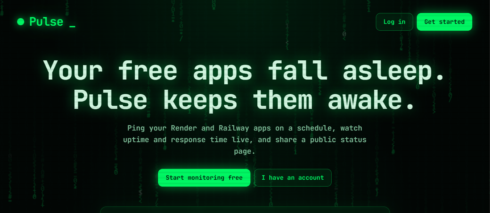
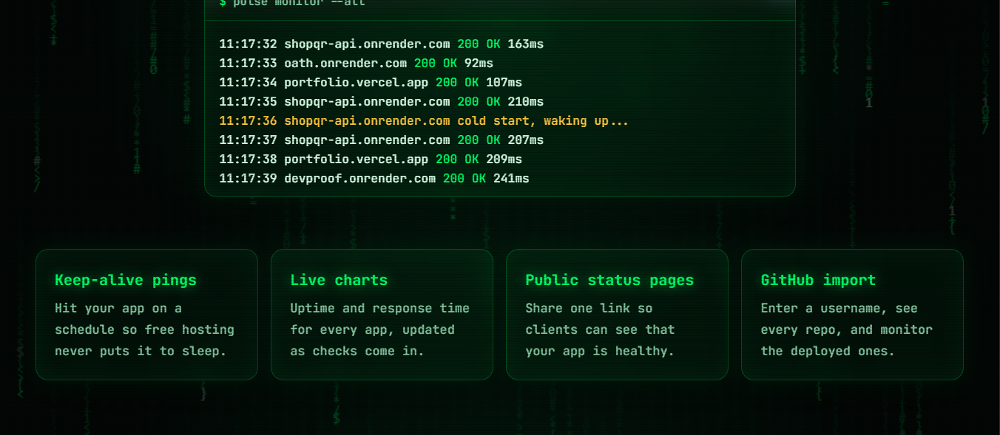
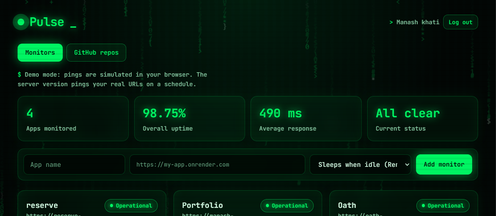
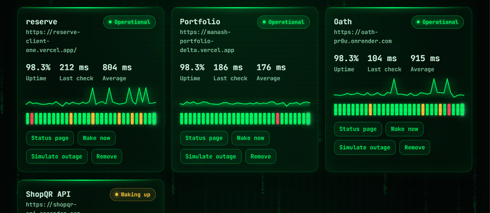
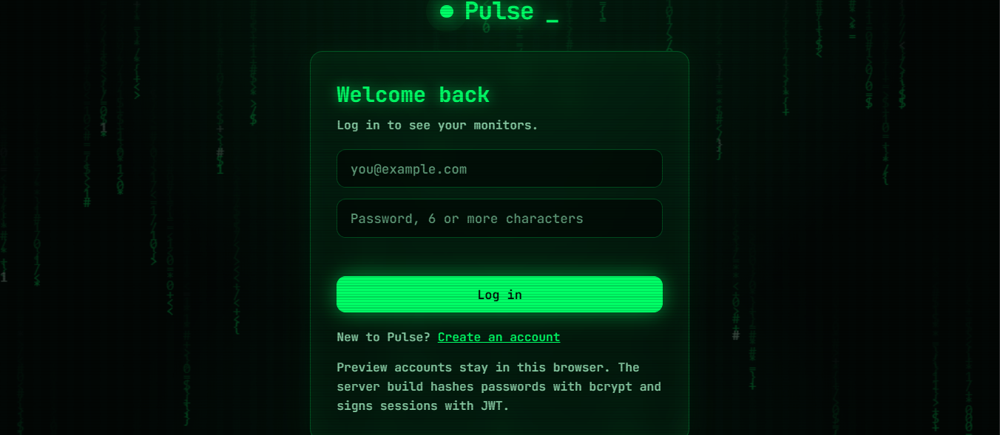

# Pulse

**Your free apps fall asleep. Pulse keeps them awake.**

Pulse is a full-stack monitoring app for free-tier hosting (Render, Railway and similar). It pings your apps on a schedule so they stop going to sleep, charts uptime and response time, and gives every app a public status page. It can also import any GitHub user's repos so you can start monitoring the deployed ones in one click.

## Screenshots

Screenshots were taken from the UI preview, so the monitor data shown is sample data.

| Landing page | Live ping feed and features |
|---|---|
|  |  |

| Dashboard | Monitor cards |
|---|---|
|  |  |

| Log in |
|---|
|  |

## Features

- **Keep-alive pings:** a cron job pings every monitor on a schedule (default every 5 minutes), even when no one has the dashboard open.
- **Live charts:** uptime, last and average response time, a response-time sparkline and a strip of the last 30 checks. Cold starts (over 5 seconds) show in amber, failures in red.
- **Public status pages:** each monitor gets a shareable `/status/:id` page that shows health and uptime without exposing the app URL.
- **GitHub import:** enter a username and see all their public repos. Repos with a homepage URL have a "Monitor this app" button.
- **Authentication:** sign up and log in with bcrypt-hashed passwords and 7-day JWT sessions. Every monitor belongs to its owner.
- **Safe by default:** monitor URLs must be public http(s) addresses, auth routes are rate limited, and the GitHub token never reaches the browser.

## Tech stack

Node.js 18+, Express, MongoDB with Mongoose, JWT, bcryptjs, node-cron, and a vanilla JS frontend (no build step).

## Getting started

1. Install dependencies:
   ```bash
   npm install
   ```
2. Copy the example environment file and fill it in:
   ```bash
   cp .env.example .env
   ```
   - `MONGODB_URI`: a free MongoDB Atlas connection string.
   - `JWT_SECRET`: any long random string.
   - `GITHUB_TOKEN`: create a token at GitHub, Settings, Developer settings, Personal access tokens. A fine-grained token with public read access is enough.
   - `PING_CRON`: optional, defaults to every 5 minutes.
3. Start the server:
   ```bash
   npm start
   ```
4. Open http://localhost:3000.

## API

| Method | Route | Auth | Description |
|---|---|---|---|
| POST | `/api/auth/signup` | No | Create an account |
| POST | `/api/auth/login` | No | Log in and get a token |
| GET | `/api/monitors` | Yes | List your monitors with check history |
| POST | `/api/monitors` | Yes | Add a monitor and run its first check |
| POST | `/api/monitors/:id/ping` | Yes | Wake and check an app now |
| DELETE | `/api/monitors/:id` | Yes | Remove a monitor |
| GET | `/api/github/:username` | Yes | List a user's public repos through your token |
| GET | `/status/:id` | No | Public status page |
| GET | `/api/health` | No | Health check |

## Deploying

Deploy to Render as a Node web service (`npm install` to build, `npm start` to run) and add the four environment variables above.

If you host Pulse on a free tier, Pulse itself will sleep and stop pinging. Point a free external pinger such as cron-job.org at `/api/health` every 10 minutes, or use an always-on host.

## License

MIT, see [LICENSE](LICENSE).
